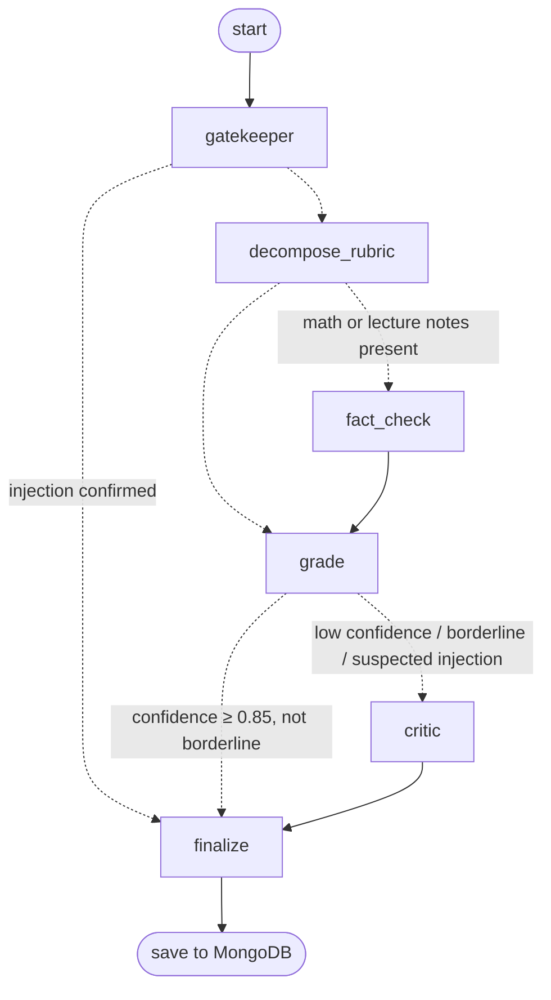

# ⚡ Perception API Backend

High-performance asynchronous backend service for **Perception**, built with **FastAPI**, **MongoDB (Beanie ODM)**, and **Groq LLM** inference.

---

## 🏛️ Architecture Overview

The backend is structured into modular layers adhering to clean separation of concerns:

```
api/app/
├── core/               # App configuration, settings & environment management
├── db/                 # Database initialization and Beanie document models
├── models/             # Pydantic schemas for request validation & response serialization
├── routes/             # RESTful API route controllers (Auth, Core evaluation)
├── mcp_server/         # MCP server: resources, tools, prompts; PAT auth; stdio entry point
└── services/           # Business logic shared by REST and MCP
    ├── access.py       # Authorization checks that deny when unsure
    ├── analytics.py    # Exam/student analytics (pure functions + loaders)
    ├── evaluation.py   # Grading orchestration and regrades
    ├── exams.py        # Exam authoring, rubric drafting/validation
    ├── repo.py         # All MongoDB queries, behind one seam
    ├── security.py     # JWT and personal-access-token primitives
    └── grading/        # LangGraph multi-agent grader: state, nodes, tools, graph
```

---

## 🧠 Agentic Grading Pipeline (LangGraph)

`POST /api/evaluate` runs a **stateful multi-agent graph** (`app/services/grading/`) instead of a single LLM call. A typed `GradingState` flows through each node, and the graph routes conditionally, so a second opinion is only paid for when the first grade is uncertain.



| Node | Model | Role |
|---|---|---|
| **Gatekeeper** | Prompt Guard 2 86M + `gpt-oss-20b` | Two classifiers run concurrently on every answer. The precision-first one (0 false positives in the benchmark) is the only one allowed to block, and it blocks **before any grading tokens are spent**. Flags from the recall-first one, or the regex, send the answer to the critic and to teacher review instead of zeroing it. Picked by a [5-detector benchmark](evals/results/golden-v1/report.md#injection-gatekeeper-benchmark): the regex alone caught 3 of 18 attacks. |
| **Rubric Decomposer** | `gpt-oss-120b` | Splits the model answer into 2-6 atomic, weighted criteria (normalized to 10 pts). **Cached on the QuestionSet** and invalidated by a hash of the model answer. |
| **Fact-Checker** (tool calling) | `gpt-oss-120b` (low reasoning effort) | Function-calling agent with two Python tools: `verify_calculation` (sympy, all of a student's working checked in one batched call) and `search_reference_material` (MongoDB `$text` search over uploaded lecture notes). Skipped when the answer has no math and no notes exist. |
| **Primary Grader** | `gpt-oss-120b` | Scores each criterion independently: Pydantic-validated JSON with `awarded`, `justification`, `confidence`. |
| **Critic / Auditor** | `gpt-oss-120b` | Adversarial review: too harsh? missed partial credit? too lenient? manipulated? Approves or adjusts, and flags large swings for teacher review. |
| **Finalize** | — | Clamps the score, runs the model-answer leak check, and assembles the audit trail. |

**Every submission stores a `grading_trace`** (node path, per-node latency, tokens, per-criterion scores, tool calls, critic verdict, `needs_review`). Teachers see it in `GET /api/teacher/question-sets/{id}/submissions`; students never do.

**Graceful degradation:** a failure in the decomposer, fact-checker or critic doesn't fail the submission. It falls back to a holistic rubric, grades without tool evidence, or keeps the draft score, and flags `needs_review`.

**Tool sandboxing:** tool arguments come from an LLM that has read untrusted student text, so `verify_calculation` uses an identifier allowlist, rejects attribute access and dunder names, parses in an inert pass to block exponent and factorial bombs, and has a 3 s timeout. `search_reference_material` receives its `question_set_id` from the server, never from the model.

### Reference material (for the fact-checker)

| Method | Endpoint | Description |
|---|---|---|
| `POST` | `/api/teacher/question-sets/{id}/references` | Upload `.pdf` / `.txt` / `.md` (≤ 5 MB), chunked and indexed |
| `GET` | `/api/teacher/question-sets/{id}/references` | List uploaded sources |
| `DELETE` | `/api/teacher/question-sets/{id}/references/{source_name}` | Remove a source |

### Configuration

| Variable | Default | |
|---|---|---|
| `GRADING_PIPELINE` | `graph` | `legacy` = original single-call grader (handy for A/B comparison) |
| `GRADER_MODEL` / `CRITIC_MODEL` | `openai/gpt-oss-120b` | |
| `GATEKEEPER_MODEL` | `meta-llama/llama-prompt-guard-2-86m` | precision-first classifier: the only one that can block |
| `GATEKEEPER_AUDIT_MODEL` | `openai/gpt-oss-20b` | recall-first classifier: routes to critic + teacher review |
| `GATEKEEPER_MODE` | `always` | `regex` = classify only after a regex hit |
| `FACT_CHECK_REASONING_EFFORT` | `low` | |
| `CONFIDENCE_THRESHOLD` | `0.85` | below this, the critic runs |
| `PASS_MARK` | `5.0` | scores within ±0.5 are borderline and audited |
| `MAX_TOOL_ROUNDS` | `3` | fact-checker tool-calling iterations |

---

## 🤖 MCP Server: Perception in Claude, Cursor and other AI assistants

The API also serves a [Model Context Protocol](https://modelcontextprotocol.io) server at **`/mcp`** (Streamable HTTP), built on the official `mcp` Python SDK 2.x. Teachers can review disputed grades, regrade, get a class misconception report and write new exams by chatting with their assistant. Students can ask for their progress and a study plan. Every MCP handler calls the same service layer as the REST API (`app/services/`), so roles and ownership are enforced in one place.

| Kind | Name | Who | What it does |
|---|---|---|---|
| Resource | `perception://exams` | both | Exams you can see, with their `exam_id` (students never get model answers) |
| Resource | `perception://rubrics/{exam_id}` | teacher | Question, model answer, rubric criteria, reference notes |
| Resource | `perception://analytics/{exam_id}/summary` | teacher | Score histogram, AI-vs-teacher agreement, latency p50/p95, tokens, critic route/adjust rates, flag counts |
| Resource | `perception://students/me/progress` | student | Your scores over time and trend |
| Tool | `list_exams` | both | Exam ids for the other tools |
| Tool | `get_flagged_submissions(exam_id, min_discrepancy, include_needs_review, limit)` | teacher | Where the Grader and Critic agents disagreed, largest gap first, with critic issues and per-criterion changes |
| Tool | `regrade_submission(submission_id, updated_rubric_note)` | teacher | Reruns the grading graph with your note and streams progress per node. The old grade goes to `regrade_history`; your final score is never touched |
| Tool | `generate_class_misconception_report(exam_id)` | teacher | Per-criterion average, share of students below half marks, grader notes from the weakest answers |
| Tool | `draft_rubric(question, model_answer)` | teacher | Runs the Rubric Decomposer agent without saving anything |
| Tool | `create_question_set(...)` | teacher | Publishes an exam (asks for confirmation via MCP elicitation when the client supports it) and reports unknown usernames |
| Tool | `get_exam_rubric`, `get_exam_analytics` | teacher | Tool versions of the resources, for clients that don't let the model read resources itself |
| Tool | `get_my_progress`, `get_improvement_plan(exam_id?)` | student | Trend, weak areas with the grader's reasons, and study pointers from notes the teacher shared |
| Prompt | `review_flagged_grades`, `class_misconception_report`, `author_exam_question`, `my_improvement_plan` | | Ready-made workflows (slash commands in most clients) |

### Connect an assistant

1. Log in to Perception, open the profile menu and choose **Connect AI assistant**, then create a personal access token. It's shown once and acts as you, so a student token can only see that student's data.
2. Add the server to your client:

```bash
# Claude Code
claude mcp add --transport http perception http://localhost:8000/mcp --header "Authorization: Bearer pcp_..."
```

```jsonc
// Cursor: ~/.cursor/mcp.json
{ "mcpServers": { "perception": { "url": "http://localhost:8000/mcp",
                                  "headers": { "Authorization": "Bearer pcp_..." } } } }
```

```jsonc
// Claude Desktop (stdio): claude_desktop_config.json. DATABASE_URL and GROQ_API_KEY are read from api/.env
{ "mcpServers": { "perception": {
    "command": "/ABSOLUTE/PATH/api/.venv/bin/python",
    "args": ["-m", "app.mcp_server"],
    "env": { "PYTHONPATH": "/ABSOLUTE/PATH/api", "PERCEPTION_TOKEN": "pcp_..." } } } }
```

To explore it by hand, run `npx @modelcontextprotocol/inspector`, choose *Streamable HTTP*, enter `http://localhost:8000/mcp` and add the `Authorization` header.

In production, set `PUBLIC_API_URL` to the deployed URL (for example `https://perception-api.onrender.com`). The MCP endpoint only accepts Host headers for localhost, `PUBLIC_API_URL` and `MCP_ALLOWED_HOSTS` (DNS-rebinding protection).

### Security model
- **Authentication:** personal access tokens (`pcp_…`, 256-bit random) are stored only as SHA-256 hashes. They expire, can be revoked, are tied to the user's role, and record when they were last used. The stdio entry point re-checks its token on every call, so revoking it takes effect immediately.
- **Authorization:** every handler goes through `app/services/access.py`. Checks deny access whenever ownership can't be confirmed.
- **Indirect prompt injection:** student answers reach the teacher's AI assistant, so they're returned inside `<untrusted_student_answer>` tags, and the server instructions tell the assistant never to act on them. Write tools are annotated as non-read-only, so clients ask for approval. A regrade can't set a score directly: it reruns the graph, which has its own injection defences.
- **Data minimisation:** student tools never return model answers. The per-criterion breakdown is released only after the teacher finalizes the grade, and study pointers only quote notes the teacher marked `student_visible`.

### Demo data

```bash
python -m scripts.seed_demo --synthetic   # no API key needed: realistic synthetic grading traces
python -m scripts.seed_demo --reset       # or grade the answers with the real multi-agent graph (needs GROQ_API_KEY)
```

This creates `demo_teacher` and `demo_student1`–`6` (password `demo-password-123`), two exams with lecture notes, and ten graded answers covering strong, partial and wrong answers, an alternative method, a blocked injection and a subtle manipulation attempt. It finalizes some grades and prints a teacher token and a student token for MCP.

---

## 📊 Evaluation

`python -m evals` grades a 66-answer golden dataset (18 prompt-injection attacks included) with the real models and compares the graph with the original single-call grader. See [`evals/README.md`](evals/README.md) for the method and [`evals/results/golden-v1/report.md`](evals/results/golden-v1/report.md) for the full report.

| On 61 answers (95% CI) | Multi-agent graph | Single-call baseline |
|---|---|---|
| Agreement with reference marks (QWK) | **0.975** [0.950–0.990] | 0.727 [0.521–0.900] |
| Mean absolute error (points / 10) | **0.43** [0.25–0.66] | 1.43 [0.82–2.08] |
| Within ±1 point | **90.2%** | 75.4% |
| Attack success rate | **0%** | 5.9% |
| Honest answers wrongly blocked | **0%** | 9.1% |
| JSON validity | 100% | 100% |
| Latency p50 / p95 | 3.08 s / 5.01 s | 0.94 s / 1.51 s |
| Tokens per answer | 2,772 | 628 |

## 🧪 Tests

```bash
pip install -r requirements-dev.txt
pytest
```

- **Grading graph:** a scripted fake LLM checks routing, short-circuiting, clamping, leak sanitisation, teacher notes and progress callbacks.
- **Auth, access control, analytics and REST routes:** run against an in-memory repository, with real JWTs and the real FastAPI routes.
- **MCP:** an in-memory MCP client covers every tool, resource and prompt. Live uvicorn servers cover bearer auth, revocation, Host-header checks and the real FastAPI mount.
- **Hermetic:** `tests/conftest.py` blanks `GROQ_API_KEY` and points `DATABASE_URL` at an unreachable address, so tests never spend API credits or touch a real database, even with a populated `.env`.

---

## 🔒 Security & Prompt Injection Defense

The legacy single-call grader (`app/services/ai_service.py`) protects the LLM against adversarial student inputs. These layers are reused inside the graph:

1. **Regex Heuristic Pre-filter**: Instantly identifies common jailbreak phrases (`"ignore previous instructions"`, `"admin override"`) before invoking the LLM, saving inference tokens.
2. **XML Isolation Tags**: Student input is encapsulated within strict `<student_answer>` delimiters and framed as passive data, preventing instruction hijack.
3. **Instruction Sandwiching**: Core grading rules are repeated after user content to preserve prompt adherence.
4. **Leakage Detection & Masking**: Evaluates the output to verify that teacher model answers are not leaked verbatim back to students.
5. **Strict JSON Schema Parsing**: Enforces `{ "score": int, "feedback": str }` output and clamps scores strictly to `[0, 10]`.

---

## 🛠️ Tech Stack

- **Framework:** [FastAPI](https://fastapi.tiangolo.com/) (Python 3.10+)
- **Server:** [Uvicorn](https://www.uvicorn.org/)
- **Database:** MongoDB via [Motor](https://motor.readthedocs.io/) & [Beanie ODM](https://beanie-odm.dev/)
- **AI Engine:** [Groq Cloud API](https://groq.com/) (`AsyncGroq`), orchestrated with [LangGraph](https://langchain-ai.github.io/langgraph/)
- **Tools:** [SymPy](https://www.sympy.org/) (math verification), [pypdf](https://pypdf.readthedocs.io/) (lecture-note ingestion)
- **Authentication:** Salted PBKDF2-SHA256 password hashing, HS256 JWTs for the web app, hashed personal access tokens for MCP clients
- **MCP:** [`mcp` Python SDK 2.x](https://github.com/modelcontextprotocol/python-sdk) (`MCPServer`, Streamable HTTP + stdio)

---

## 🚀 Local Development Setup

1. **Navigate to the API folder:**
   ```bash
   cd api
   ```

2. **Create & activate virtual environment:**
   ```bash
   python -m venv venv
   source venv/bin/activate  # Windows: venv\Scripts\activate
   ```

3. **Install dependencies:**
   ```bash
   pip install -r requirements.txt
   ```

4. **Configure environment:**
   ```bash
   cp .env.example .env
   # Populate DATABASE_URL and GROQ_API_KEY
   ```

5. **Start development server:**
   ```bash
   uvicorn app.main:app --reload --port 8000
   ```

6. **Interactive Documentation:**
   - Swagger UI: [http://localhost:8000/docs](http://localhost:8000/docs)
   - ReDoc: [http://localhost:8000/redoc](http://localhost:8000/redoc)

